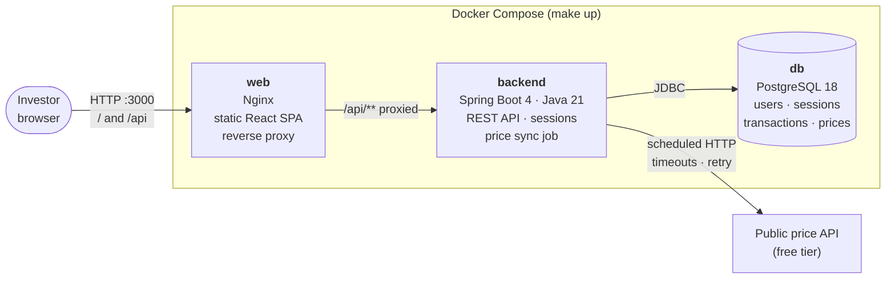
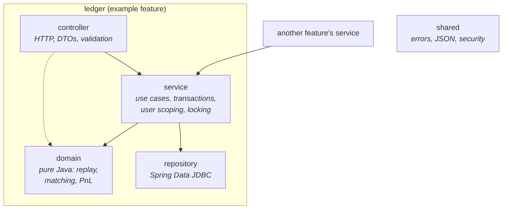
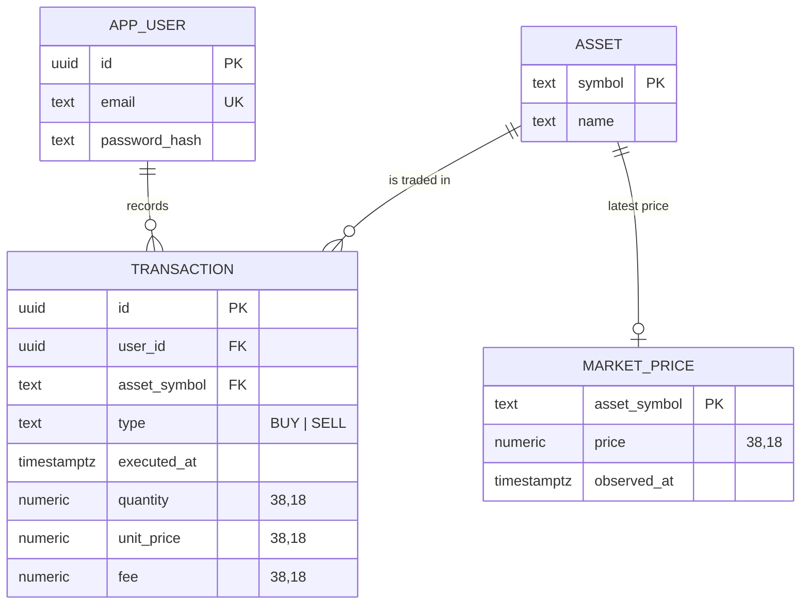
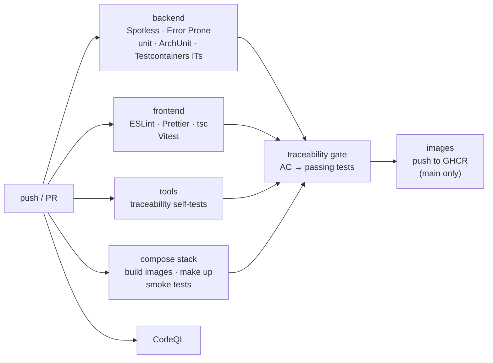

# Architecture

Plainledger is a single-page web app backed by one Spring Boot service and one PostgreSQL database. Everything runs locally with `make up`. This page describes the target MVP architecture; the feature map in the [product spec](../specs/000-product/spec.md#5-scope) says which parts are built.

## System overview



- **One origin.** Nginx serves the SPA and proxies `/api` to the backend, so the session cookie works without CORS ([ADR-0007](adr/0007-server-side-sessions.md)).
- **Only the backend talks to the internet**, and only to fetch prices. A failing price API makes prices stale, never wrong; the age of each price is shown (RULE-12).

## Backend structure

Package by feature, with layers inside each feature ([ADR-0003](adr/0003-feature-packages-with-layers.md)). Arrows are allowed dependencies, enforced by ArchUnit.



| Feature package | Responsibility | Spec |
|---|---|---|
| `accounts` | Registration, login, logout, current user | 002 |
| `ledger` | Transactions CRUD, replay validation, per-asset write lock | 003 |
| `purchases` | Matching engine, purchases, sell allocations, realized PnL | 004 |
| `prices` | `PriceProvider` adapter, scheduled sync, unrealized PnL | 005 |
| `timeline` | User's own operations over time | 006 |

## How a write works

Derived state is never stored ([ADR-0005](adr/0005-compute-derived-state-on-read.md)), so a write only has to keep the ledger valid ([ADR-0004](adr/0004-mutable-ledger.md)).

```mermaid
sequenceDiagram
    autonumber
    participant UI as SPA
    participant API as LedgerController
    participant SVC as LedgerService
    participant DB as PostgreSQL
    participant ENG as Replay engine (domain)

    UI->>API: PUT /api/transactions/{id} (decimals as strings)
    API->>SVC: update(userId, id, command)
    SVC->>DB: BEGIN; pg_advisory_xact_lock(user, asset)
    SVC->>DB: load the asset's transactions (scoped to user)
    SVC->>ENG: replay(history with the change applied)
    alt a sell would exceed the open quantity
        ENG-->>SVC: violation (first offending sell)
        SVC-->>API: reject, ROLLBACK
        API-->>UI: 409 Problem Details
    else history is valid
        SVC->>DB: UPDATE transaction; COMMIT
        API-->>UI: 200
    end
```

The advisory lock serializes writes per (user, asset) (RULE-15). Without it, two concurrent sells could each pass validation alone and oversell together.

## How a read works

`GET /api/portfolio` loads the user's transactions, replays each asset in the domain engine (RULE-04, RULE-05), and combines the result with the latest stored market prices (RULE-12). Nothing is cached in the MVP; NFR-05 sets the performance budget, and ADR-0005 describes the scaling path.

## Data model (MVP)



Spring Session tables are omitted. Purchases and allocations have no tables: they are derived on read.

## Build and delivery



See [testing-strategy.md](testing-strategy.md) and [ADR-0009](adr/0009-acceptance-criteria-traceability.md).
